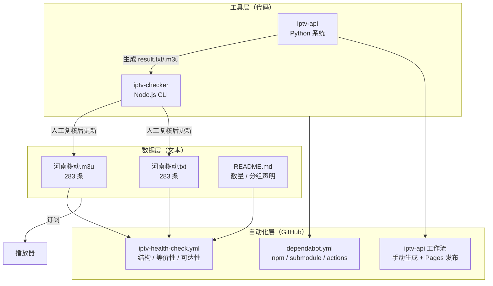
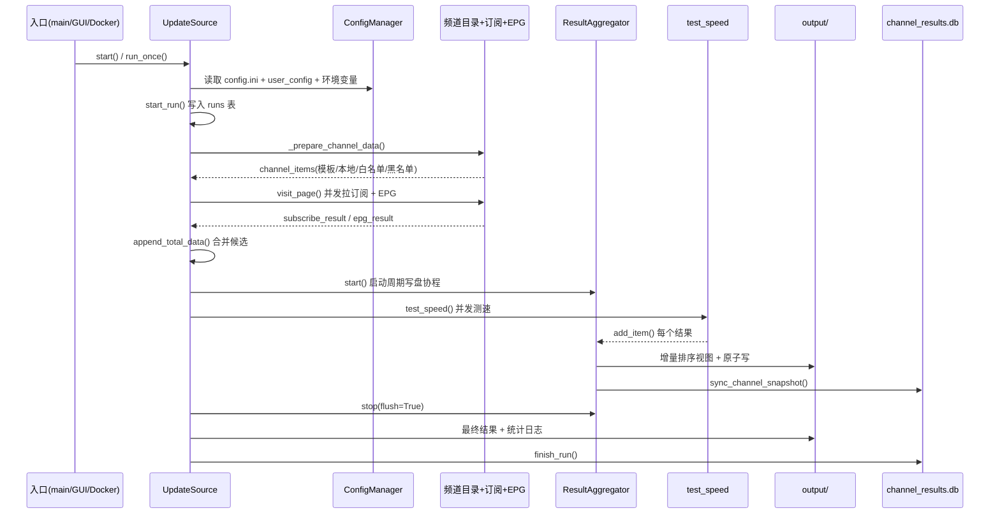
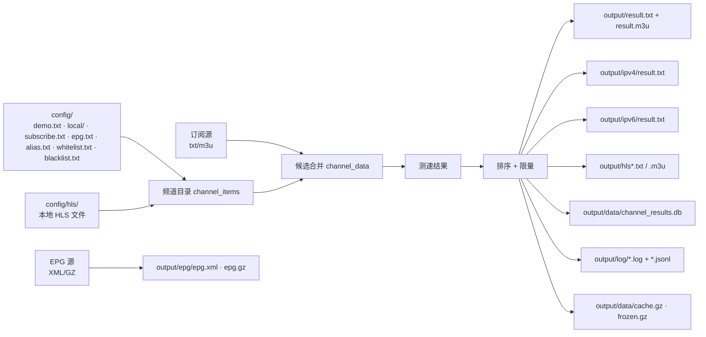
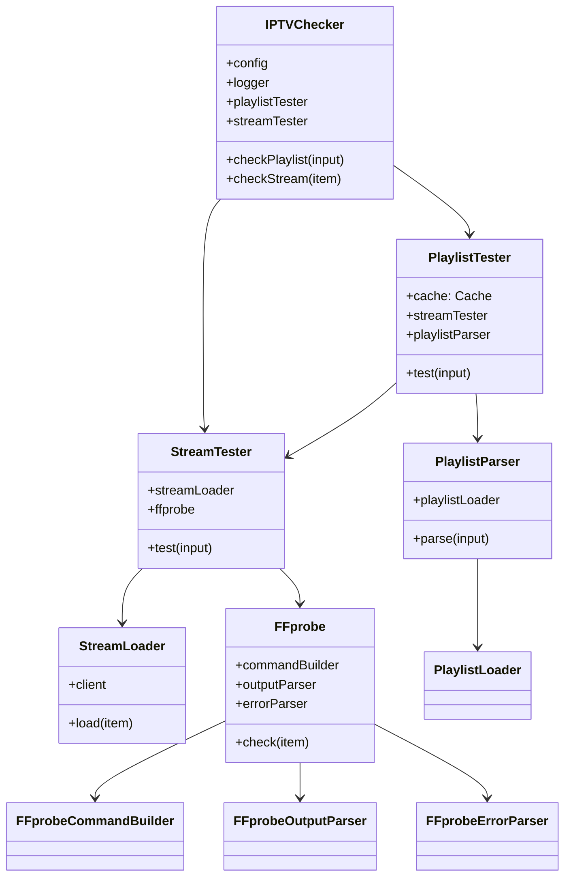

# 02 · 整体架构

## 1. 分层视图

整个仓库可按"数据 → 工具 → 自动化"三层理解，层间只通过**文件产物**或**GitHub API**交互，没有运行时耦合。



**分层原则：**

- 数据层不依赖任何代码，单独克隆 `河南移动/` 即可使用。
- 工具层可独立运行，失败不影响已发布数据。
- 自动化层只读数据、只开 Issue，**不自动提交**，避免机器人改坏源。

---

## 2. 仓库级组件关系

| 组件 | 输入 | 输出 | 依赖方向 |
|---|---|---|---|
| `河南移动/*` | 采集结果 | 订阅文件 | 无 |
| `iptv-checker` | m3u 文件 / URL / stdin | `iptv-checker_<ts>/online.m3u`、`failed.m3u` | → 外部 ffprobe |
| `iptv-api` | `config/` + 订阅源 + 本地源 | `output/` 下 txt/m3u/EPG/日志/DB | → 外部网络、ffmpeg、nginx-rtmp |
| `iptv-health-check` | `河南移动/` + `README.md` | Step Summary、Issue | → GitHub API、raw.githubusercontent.com |

---

## 3. iptv-api 主流程

### 3.1 总览

`UpdateSource` 是编排核心，位于 [main.py](../../tools/iptv-api/main.py#L48)。主流程按 **6 个阶段**串行推进，阶段内部并发。



### 3.2 阶段拆解

| 阶段 | 方法 | 关键动作 | 源码 |
|---|---|---|---|
| 0 启动 | `run_once` / `start` | 读取开关、检测 IPv6、选择单次或调度 | [main.py L842-L904](../../tools/iptv-api/main.py#L842-L904) |
| 1 准备 | `_prepare_channel_data` | 重载别名、加载白/黑名单、解析模板与本地源、加载历史缓存 | [L152-L175](../../tools/iptv-api/main.py#L152-L175) |
| 2 采集 | `visit_page` → `_fetch_subscribe` / `_fetch_epg` | 订阅与 EPG 并发；支持"订阅中发现 EPG 地址"串联模式 | [L243-L356](../../tools/iptv-api/main.py#L243-L356) |
| 3 聚合 | `append_total_data` + `_diagnose_aggregated_data` | 模板频道 ↔ 订阅频道按规范化名称匹配；空数据诊断 | [L650-L658](../../tools/iptv-api/main.py#L650-L658) |
| 4 测速 | `_run_speed_test` → `test_speed` | quick / full / manual 三种模式；实时回调 | [L414-L558](../../tools/iptv-api/main.py#L414-L558) |
| 5 输出 | `_stop_aggregator` + `write_channel_to_file` | 排序、限制条数、生成 txt/m3u、IPv4/IPv6/HLS 变体 | [L726-L749](../../tools/iptv-api/main.py#L726-L749) |
| 6 收尾 | `finally` | `write_run_state` + `finish_run` + 清理截图 | [L825-L837](../../tools/iptv-api/main.py#L825-L837) |

### 3.3 分支：manual 测速模式

`speed_test_mode = manual` 时**不做自动测速**：仅刷新候选池，清空聚合器结果，把频道候选直接交给 GUI 手动重测（[main.py L667-L717](../../tools/iptv-api/main.py#L667-L717)）。
这是 GUI 场景的"先采集、后按需测"路径，避免每次启动都跑完整测速。

### 3.4 分支：调度模式

`start()` 的决策链（[L885-L904](../../tools/iptv-api/main.py#L885-L904)）：

```text
open_update == False            → 直接退出
非 GitHub Actions 且配置了 interval/time → scheduler()（内部先跑一次 startup）
否则 update_startup == True     → main() 单次
```

`scheduler()` 支持两种模式（[L915-L969](../../tools/iptv-api/main.py#L915-L969)）：

- `interval`：固定小时数间隔；
- `time`：每天指定时刻（支持多个 `HH:MM`），使用 `pytz` 时区。

---

## 4. 数据流与落盘



**写入策略：**

- 结果文件采用**临时文件 + `os.replace` 原子替换**（[channel.py L1389-L1400](../../tools/iptv-api/utils/channel.py#L1389-L1400)），避免播放器读到半截文件。
- `process_write_content` 先计算渲染签名（URL 集合 + 关键配置哈希），内容未变则跳过写盘（[L1340-L1364](../../tools/iptv-api/utils/channel.py#L1340-L1364)）。
- 实时写入由 `ResultAggregator` 每 `10s` 或累计 `max(25, output_urls_limit)` 条触发，带 `2s` 去抖（[main.py L387-L399](../../tools/iptv-api/main.py#L387-L399)）。

---

## 5. iptv-checker 架构

### 5.1 类协作



### 5.2 单条链接的检查链路

```text
PlaylistParser.parse
  ├─ 对象含 items      → 直接返回
  ├─ Buffer            → utf8 字符串
  ├─ Web URL           → PlaylistLoader（axios GET）
  └─ 本地路径存在      → readFileSync
        ↓ 必须以 #EXTM3U 开头
  iptv-playlist-parser → { items: [{ name, url, raw, http, ... }] }

PlaylistTester.test
  ├─ 校验 ffprobe 是否安装
  ├─ URL 规范化（去协议）→ Cache 去重（重复 → DUPLICATE）
  ├─ 非 URI → INVALID_URI
  └─ parallel == 1 ? 串行 : eachLimit(queue, parallel)

StreamTester.test
  ├─ delay 等待（测试环境跳过）
  ├─ StreamLoader.load：HTTP 预检（UA / Referer / 代理 / 超时 / 重定向去重）
  └─ FFprobe.check：执行 ffprobe，解析 streams/format
```

### 5.3 设计要点

- **两段式检查**：先 HTTP 层快速失败（`StreamLoader`），再 ffprobe 媒体层确认（`FFprobe`）。HTTP 已失败则不启动 ffprobe，节省进程开销。
- **内容超限即视为可达**：响应体超过 `100 KB` 抛 `HTTP_MAX_CONTENT_LENGTH_EXCEEDED` 时返回成功，交由 ffprobe 判断（[StreamLoader.js L131-L133](../../tools/iptv-checker/src/core/StreamLoader.js#L131-L133)）。
- **重定向去重**：请求后的 `responseUrl` 规范化后与缓存比对，避免多个入口指向同一源（[L118-L122](../../tools/iptv-checker/src/core/StreamLoader.js#L118-L122)）。
- **状态码映射**：HTTP 错误码与 FFmpeg 错误文本分别由 `HttpErrorParser` 与 `FFprobeErrorParser` 归一为稳定的 `code`，再由 [errors.js](../../tools/iptv-checker/src/errors.js) 映射为人类可读消息。

---

## 6. 关键设计决策

| 决策 | 做法 | 原因与代价 |
|---|---|---|
| AGPL 隔离 | `iptv-api` 用 submodule，仅记录 commit SHA | 避免组合作品认定；代价是克隆后必须 `submodule update --init` |
| 数据与工具分离 | 主仓库无运行时依赖，只有文本 + 工具快照 | 数据可单独使用；工具升级互不影响 |
| CI 不探活 | 日常只校验结构/等价性/可达性，探活作为手动 job | runner 到运营商内网不可达，避免长期红灯 |
| 探活降并发 | 文档与配置都强调 `-p 1`、冷却复验 | CDN 高频请求返回 404，高并发会误判 |
| 实时写盘 | `ResultAggregator` 周期 flush + 原子替换 | 更新过程中即可订阅；需要去抖与签名防抖 |
| 双存储 | 文件结果（播放器用）+ SQLite（GUI/服务查询用） | 播放器只认文本；GUI 需要结构化查询与统计 |
| WAL 降级 | WAL 初始化失败自动切 `DELETE` journal | 适配不支持 WAL 的网络盘 / 容器卷 |
| 配置分层 | 默认 `config.ini` ← `user_config.ini` ← 环境变量 | 容器可纯环境变量部署，又保留文件可读性 |
| 性能自适应 | 按 CPU/内存（含 cgroup 配额）选并发 | 同一镜像可跑在 1 核 NAS 与 16 核服务器 |
| 不自动提交 | 自检失败只开/更新一条 Issue | 避免机器人覆盖人工修正的数据 |

---

## 7. 并发与资源模型

iptv-api 的并发由 [performance.py](../../tools/iptv-api/utils/performance.py#L97-L162) 统一计算，分为：

| 维度 | 作用 | powersave | balance | fast |
|---|---|---|---|---|
| `speed_test_concurrency` | 测速 HTTP 并发 | 3 | `cpu*2`（5–10） | `cpu*2.5`（8–16） |
| `probe_concurrency` | ffprobe 并发 | 1 | `cpu/2`（1–2） | `cpu/2`（1–4） |
| `fetch_workers` | 订阅拉取并发 | 4 | `cpu*2`（6–10） | `cpu*2`（8–16） |
| `epg_fetch_concurrency` | EPG 拉取并发 | 1 | 2 | 4（内存 ≥ 8 GB） |
| `epg_parse_concurrency` | EPG 解析并发 | 1 | 1 | 2（内存 ≥ 8 GB） |

同时受内存上限二次约束（`memory_gb * 3` 等），并允许 `speed_test_limit > 0` 覆盖测速并发（1–64）。

**取消与暂停：**

- 暂停：`UpdateSource.pause()` 设置线程安全的 `threading.Event`，各阶段在循环点调用 `await wait_if_paused()`（[main.py L86-L127](../../tools/iptv-api/main.py#L86-L127)）。
- 取消：`stop()` 取消 `self.tasks` 并置位 `stop_event`；`asyncio.CancelledError` 分支会**丢弃未完成 flush** 并重新抛出，避免把半成品当最终结果（[L719-L724](../../tools/iptv-api/main.py#L719-L724)）。

iptv-checker 的并发则简单得多：`parallel == 1` 串行（运营商源推荐），否则 `async.eachLimit` 批处理，`delay` 为每请求间隔。

---

## 8. 可观测性

iptv-api 有统一事件上报层 [reporting.py](../../tools/iptv-api/utils/reporting.py)：

- 控制台（rich / 纯文本，容器内 `IPTV_API_PLAIN_OUTPUT=1`）；
- `runtime.jsonl` 结构化事件；
- 分主题日志：`speed_test.log`、`result.log`、`statistic.log`、`unmatch.log`；
- `run_state.json`：`never_run / running / completed / completed_empty / failed / cancelled`；
- SQLite 的 `runs`、`operation_history`、`stream_samples` 表。

iptv-checker 则仅用 `Logger`（受 `debug` 开关控制）与命令行进度条。

---

## 9. 扩展点

| 想做的事 | 改哪里 |
|---|---|
| 增加频道模板 | `tools/iptv-api/config/demo.txt` |
| 增加别名 / 白名单 / 黑名单 | `alias.txt`、`whitelist.txt`、`blacklist.txt` |
| 增加订阅 / EPG 源 | `subscribe.txt`、`epg.txt` |
| 调整输出格式与条数 | `config.ini` 的 `output_urls_limit`、`open_m3u_result`、`sort_by` |
| 新增结果路由 | [service/app.py](../../tools/iptv-api/service/app.py#L120-L294) 增加 Flask 路由 |
| 新增检查维度 | `.github/workflows/iptv-health-check.yml` 的 lint job |
| 新增探活规则 | `tools/iptv-checker/src/core/` 增加 Parser / 修改 `errors.js` |
