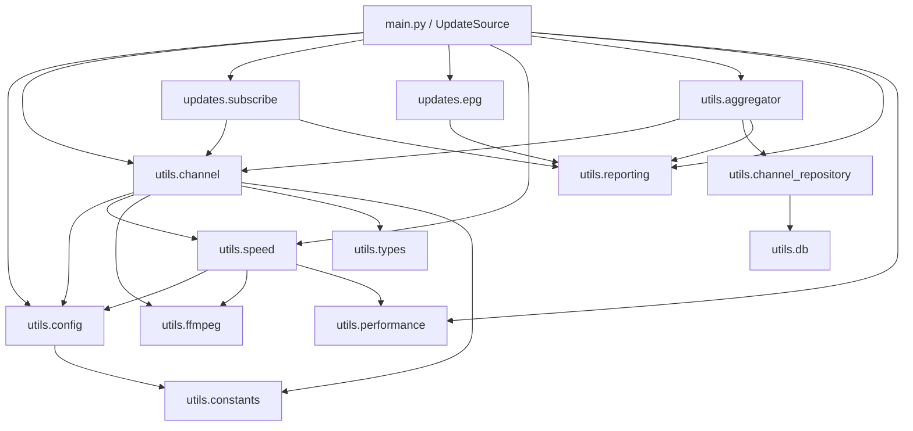

# 03 · 模块职责

本章按子系统列出每个模块的**职责边界**与**主要入口**，便于定位"某个功能该改哪个文件"。

---

## 1. 主仓库（数据与自动化）

| 路径 | 职责 | 关键内容 |
|---|---|---|
| [河南移动/河南移动.m3u](../../河南移动/河南移动.m3u) | 标准播放器订阅源 | `#EXTM3U` + `x-tvg-url`；每条含 `tvg-id/tvg-name/group-title` |
| [河南移动/河南移动.txt](../../河南移动/河南移动.txt) | DIYP 订阅源 | `组名,#genre#` + `频道名,URL` |
| [README.md](../../README.md) | 使用者文档 + **数量/分组声明的唯一事实源** | 频道构成表被 CI 反向校验 |
| [.github/workflows/iptv-health-check.yml](../../.github/workflows/iptv-health-check.yml) | 仓库自检 | lint / probe / notify 三 job |
| [.github/scripts/check_playlist_equivalence.py](../../.github/scripts/check_playlist_equivalence.py) | m3u ↔ txt 等价性 | 频道名集合、URL 集合、同名 URL 映射 |
| [.github/dependabot.yml](../../.github/dependabot.yml) | 依赖更新 | npm / gitsubmodule / github-actions |
| [docs/ecosystem.md](../../docs/ecosystem.md) | 生态索引 | 上游源库、组件串联方式、许可证提示 |
| [docs/河南移动-河南电信频道对照.md](../../docs/河南移动-河南电信频道对照.md) | 跨运营商对照 | 移动 132 个唯一频道 ↔ 电信 58 条：54 命中 / 78 缺口 / 5 反向；含电信源实测 |
| [THIRD-PARTY.md](../../THIRD-PARTY.md) | 合规清单 | 来源、许可证、快照 commit、合规说明 |
| [.gitmodules](../../.gitmodules) | 子模块定义 | `tools/iptv-api` → `Guovin/iptv-api`，`shallow = true` |

> 主仓库**没有** `package.json` / `requirements.txt` / 构建脚本，它本身不可"运行"。所谓"运行"指使用其中的数据或进入 `tools/` 下的工具。

---

## 2. iptv-checker（Node.js CLI）

### 2.1 入口与装配

| 模块 | 职责 | 关键符号 |
|---|---|---|
| [bin/iptv-checker.js](../../tools/iptv-checker/bin/iptv-checker.js) | CLI 参数解析、输出目录创建、进度条、统计与退出码 | `program`、`config`、`init()`、`afterEach()`、`setUp()` |
| [src/index.js](../../tools/iptv-checker/src/index.js) | 公共 API 装配与默认配置 | `IPTVChecker`、`defaultConfig` |
| [src/constants.js](../../tools/iptv-checker/src/constants.js) | 测试环境开关 | `TESTING` |
| [src/errors.js](../../tools/iptv-checker/src/errors.js) | 错误码 → 人类可读消息 | `errors` 字典 |
| [src/index.d.ts](../../tools/iptv-checker/src/index.d.ts) | TypeScript 类型声明 | `IPTVChecker` 等 |

### 2.2 核心检查链

| 模块 | 职责 | 关键符号 |
|---|---|---|
| [core/PlaylistTester.js](../../tools/iptv-checker/src/core/PlaylistTester.js) | 播放列表级编排：解析 → 去重 → 并发调度 | `PlaylistTester.test()` |
| [core/PlaylistParser.js](../../tools/iptv-checker/src/core/PlaylistParser.js) | 输入归一化（对象/Buffer/URL/路径）并解析 M3U | `PlaylistParser.parse()` |
| [core/PlaylistLoader.js](../../tools/iptv-checker/src/core/PlaylistLoader.js) | 远程播放列表下载 | `PlaylistLoader.load()` |
| [core/StreamTester.js](../../tools/iptv-checker/src/core/StreamTester.js) | 单条流检查编排：预检 → ffprobe → 回调 | `StreamTester.test()` |
| [core/StreamLoader.js](../../tools/iptv-checker/src/core/StreamLoader.js) | HTTP 预检：UA/Referer/代理/超时/重定向去重 | `StreamLoader.load()` |
| [core/FFprobe.js](../../tools/iptv-checker/src/core/FFprobe.js) | 执行 ffprobe 并归一出 `status` | `FFprobe.check()` |
| [core/FFprobeCommandBuilder.js](../../tools/iptv-checker/src/core/FFprobeCommandBuilder.js) | 拼装 ffprobe 命令行 | `build(item)` |
| [core/FFprobeOutputParser.js](../../tools/iptv-checker/src/core/FFprobeOutputParser.js) | 解析 stdout JSON + stderr 请求日志 | `parse(stdout, stderr)` |
| [core/FFprobeErrorParser.js](../../tools/iptv-checker/src/core/FFprobeErrorParser.js) | FFmpeg 错误文本 → 错误码 | `parse(output, item)` |
| [core/HttpErrorParser.js](../../tools/iptv-checker/src/core/HttpErrorParser.js) | axios/Node 错误 → 错误码 | `parse(err)` |

### 2.3 基础设施

| 模块 | 职责 |
|---|---|
| [core/Cache.js](../../tools/iptv-checker/src/core/Cache.js) | 基于 `Set` 的 URL 去重缓存（`add/has/clear`） |
| [core/Logger.js](../../tools/iptv-checker/src/core/Logger.js) | `info/error/debug`，`debug` 受配置控制，对象自动 JSON 美化 |
| [core/ProxyParser.js](../../tools/iptv-checker/src/core/ProxyParser.js) | 代理 URL 解析为 `protocol/host/port/auth` |
| [core/utils.js](../../tools/iptv-checker/src/core/utils.js) | `normalizeUrl`、`isUri`、`isValidUserAgent` |
| [core/Playlist.js](../../tools/iptv-checker/src/core/Playlist.js) | 结果 m3u 追加写（失败原因写入 `#EXTINF` 行尾） |
| [tests/](../../tools/iptv-checker/tests/) | Jest 测试、`__mocks__`（ffprobe/msw/node）与样例数据 |

### 2.4 模块依赖方向

```text
bin ──► index ──► PlaylistTester ──► StreamTester ──► StreamLoader
                      │                  │              └─► HttpErrorParser / ProxyParser / utils
                      │                  └─► FFprobe ──► CommandBuilder / OutputParser / ErrorParser
                      ├─► PlaylistParser ──► PlaylistLoader
                      └─► Cache / Logger / utils
```

单向依赖、无循环；`Cache` 由 `PlaylistTester` 创建并注入 `StreamTester` 与 `StreamLoader`，实现跨阶段去重共享。

---

## 3. iptv-api（Python 系统）

### 3.1 入口层

| 模块 | 职责 |
|---|---|
| [main.py](../../tools/iptv-api/main.py) | CLI 入口 + `UpdateSource` 编排器（准备/采集/聚合/测速/输出/调度/暂停） |
| [service/app.py](../../tools/iptv-api/service/app.py) | Flask 结果服务：结果文件、EPG、日志、HLS 代理、RTMP 控制、运行时信息 |
| [desktop_ui/app.py](../../tools/iptv-api/desktop_ui/app.py) | 桌面 GUI 主入口；支持 `--service`（内嵌服务）与 `--verify-runtime` |
| [tkinter_ui/tkinter_ui.py](../../tools/iptv-api/tkinter_ui/tkinter_ui.py) | **已弃用**的旧 Tkinter 界面，仅兼容保留 |
| [entrypoint.sh](../../tools/iptv-api/entrypoint.sh) | 容器入口：复制默认配置 → 渲染 nginx 配置 → 启动 nginx + main.py + gunicorn |

### 3.2 配置与基础设施

| 模块 | 职责 | 关键符号 |
|---|---|---|
| [utils/config.py](../../tools/iptv-api/utils/config.py) | 配置加载、属性访问、校验、环境变量覆盖 | `ConfigManager`、`ConfigRule`、`ConfigValidationError` |
| [utils/constants.py](../../tools/iptv-api/utils/constants.py) | 全部路径与正则 | `*_path`、`*_pattern` |
| [utils/types.py](../../tools/iptv-api/utils/types.py) | 类型契约 | `ChannelData`、`CategoryChannelData`、`TestResult` |
| [utils/i18n.py](../../tools/iptv-api/utils/i18n.py) | 翻译函数 | `t(key)` |
| [utils/alias.py](../../tools/iptv-api/utils/alias.py) | 频道别名 / 正则别名 → 主名 | `Alias`、`channel_alias` |
| [utils/resources.py](../../tools/iptv-api/utils/resources.py) | 资源路径解析（兼容 PyInstaller） | `resource_path`、`bundled_resource_path` |
| [utils/identity.py](../../tools/iptv-api/utils/identity.py) | 结果稳定 ID（URL + headers 哈希） | `stable_result_id` |
| [utils/retry.py](../../tools/iptv-api/utils/retry.py) | 通用重试装饰器 | — |
| [utils/process.py](../../tools/iptv-api/utils/process.py) | 子进程环境（直连、无窗口） | `direct_network_env`、`no_window_process_kwargs` |
| [utils/performance.py](../../tools/iptv-api/utils/performance.py) | 资源探测与并发档位 | `get_performance_settings`、`PerformanceSettings` |
| [utils/reporting.py](../../tools/iptv-api/utils/reporting.py) | 统一事件/进度/摘要上报，URL 脱敏 | `Reporter`、`ReportEvent` |
| [utils/artifacts.py](../../tools/iptv-api/utils/artifacts.py) | 文本 + JSONL 双写，带条数上限 | `ArtifactWriter` |
| [utils/run_state.py](../../tools/iptv-api/utils/run_state.py) | `run_state.json` 原子读写 | `read_run_state`、`write_run_state` |
| [utils/version_check.py](../../tools/iptv-api/utils/version_check.py) | 版本信息与新版本检查 | `log_new_version_if_available` |
| [utils/whitelist.py](../../tools/iptv-api/utils/whitelist.py) | 白名单映射与匹配 | `load_whitelist_maps` |
| [utils/user_actions.py](../../tools/iptv-api/utils/user_actions.py) | GUI 写回配置（模板/本地/白黑名单） | `add_channel`、`add_to_whitelist` |

### 3.3 频道目录与数据合并

| 模块 | 职责 |
|---|---|
| [utils/channel.py](../../tools/iptv-api/utils/channel.py) | **核心业务库**：模板解析、频道目录、候选合并、测速、有效性判定、排序、统计、结果写盘 |
| [utils/channel_quality.py](../../tools/iptv-api/utils/channel_quality.py) | 单条结果可播性判定（速率/分辨率/补充模式） |
| [utils/channel_operations.py](../../tools/iptv-api/utils/channel_operations.py) | GUI 单条/单频道/整分类重测、截图、重排发布 |
| [utils/local_source_importer.py](../../tools/iptv-api/utils/local_source_importer.py) | 导入本地 txt/m3u 到 `config/local.txt` |
| [utils/frozen.py](../../tools/iptv-api/utils/frozen.py) | 失效 URL 冻结集合（跨轮次记忆） |
| [utils/ip_checker/ip_checker.py](../../tools/iptv-api/utils/ip_checker/ip_checker.py) | 基于 `qqwry.ipdb` 的归属地/运营商查询、IPv4/IPv6 判定 |

### 3.4 采集

| 模块 | 职责 |
|---|---|
| [updates/subscribe/request.py](../../tools/iptv-api/updates/subscribe/request.py) | 并发拉取订阅源，解析 txt/m3u，按频道名匹配，记录未匹配与自动停用 |
| [updates/subscribe/__init__.py](../../tools/iptv-api/updates/subscribe/__init__.py) | 导出 `get_channels_by_subscribe_urls` |
| [updates/epg/request.py](../../tools/iptv-api/updates/epg/request.py) | 并发拉取 EPG，流式 XML 解析，去重、优先级合并、资源限额 |
| [updates/epg/tools.py](../../tools/iptv-api/updates/epg/tools.py) | `write_to_xml` / `compress_to_gz` |
| [updates/epg/__init__.py](../../tools/iptv-api/updates/epg/__init__.py) | 导出 `get_epg` |

### 3.5 测速与媒体探测

| 模块 | 职责 |
|---|---|
| [utils/speed.py](../../tools/iptv-api/utils/speed.py) | aiohttp 测速：下载速率、延迟、分辨率、m3u8 校验、广告列表识别、结果缓存与排序键 |
| [utils/ffmpeg/ffmpeg.py](../../tools/iptv-api/utils/ffmpeg/ffmpeg.py) | FFmpeg 可用性检查、按码率采样测速 |
| [utils/ffmpeg/probe.py](../../tools/iptv-api/utils/ffmpeg/probe.py) | ffprobe 元数据（分辨率/编码/fps），异步与同步封装 |
| [utils/ffmpeg/screenshot.py](../../tools/iptv-api/utils/ffmpeg/screenshot.py) | 截取播放画面并解析元数据 |
| [utils/ffmpeg/executable.py](../../tools/iptv-api/utils/ffmpeg/executable.py) | 定位 ffmpeg/ffprobe（含打包资源） |
| [utils/requests/async_tools.py](../../tools/iptv-api/utils/requests/async_tools.py) | 统一 headers、候选 URL 依次尝试、IPv6 支持检测 |
| [utils/requests/tools.py](../../tools/iptv-api/utils/requests/tools.py) | requests/aiohttp 通用请求封装 |

### 3.6 结果输出与持久化

| 模块 | 职责 | 关键符号 |
|---|---|---|
| [utils/aggregator.py](../../tools/iptv-api/utils/aggregator.py) | 结果聚合器：增量排序视图、周期 flush、去抖、历史保值、DB 快照同步 | `ResultAggregator` |
| [utils/channel_repository.py](../../tools/iptv-api/utils/channel_repository.py) | 频道/结果/候选/截图/操作/采样的 SQLite 仓储与查询 | `sync_channel_snapshot`、`list_channels`、`start_run` |
| [utils/db.py](../../tools/iptv-api/utils/db.py) | 轻量结果表（`result_data`）与 WAL→DELETE 降级 | `get_db_connection`、`sync_result_data` |
| [utils/diagnostics.py](../../tools/iptv-api/utils/diagnostics.py) | 运行诊断信息收集 | — |
| [utils/nginx-rtmp-win32/](../../tools/iptv-api/utils/nginx-rtmp-win32/) | Windows 随包 nginx-rtmp 可执行与配置 | `nginx.exe`、`conf/` |

### 3.7 Web 服务与推流

| 模块 | 职责 |
|---|---|
| [service/app.py](../../tools/iptv-api/service/app.py) | 结果路由、日志路由、`/hls_proxy/<channel_id>`、RTMP 控制 API、父进程守护 |
| [service/rtmp.py](../../tools/iptv-api/service/rtmp.py) | HLS→RTMP 转发、并发容量、空闲回收、编码器选择与转码策略、nginx 生命周期 |
| [utils/rtmp_runtime.py](../../tools/iptv-api/utils/rtmp_runtime.py) | 检测/安装 RTMP 运行时（Windows/macOS 路径与模块） |
| [utils/rtmp_stats.py](../../tools/iptv-api/utils/rtmp_stats.py) | 解析 nginx-rtmp 统计页 |
| [nginx.conf.template](../../tools/iptv-api/nginx.conf.template) / [service/nginx.conf.template](../../tools/iptv-api/service/nginx.conf.template) | HTTP + RTMP 站点模板 |
| [stat.xsl](../../tools/iptv-api/stat.xsl) | RTMP 统计 XSL |

### 3.8 桌面 GUI（PySide6）

| 模块 | 职责 |
|---|---|
| [desktop_ui/main_window.py](../../tools/iptv-api/desktop_ui/main_window.py) | 主窗口、导航、页面装配 |
| [desktop_ui/controller.py](../../tools/iptv-api/desktop_ui/controller.py) | 更新任务线程、暂停/取消、事件 → UI 状态 |
| [desktop_ui/pages/dashboard.py](../../tools/iptv-api/desktop_ui/pages/dashboard.py) | 首页仪表盘（运行状态、进度、指标卡） |
| [desktop_ui/pages/channels.py](../../tools/iptv-api/desktop_ui/pages/channels.py) | 频道与结果管理、重测、截图、选择模式 |
| [desktop_ui/pages/sources.py](../../tools/iptv-api/desktop_ui/pages/sources.py) | 数据源（模板/订阅/EPG/本地/别名/白黑名单）编辑 |
| [desktop_ui/pages/tasks.py](../../tools/iptv-api/desktop_ui/pages/tasks.py) | 任务历史（`runs` 表） |
| [desktop_ui/pages/logs.py](../../tools/iptv-api/desktop_ui/pages/logs.py) | 日志查看 |
| [desktop_ui/pages/rtmp.py](../../tools/iptv-api/desktop_ui/pages/rtmp.py) | 推流监控 |
| [desktop_ui/pages/settings.py](../../tools/iptv-api/desktop_ui/pages/settings.py) | 配置编辑、目录迁移、外观 |
| [desktop_ui/pages/about.py](../../tools/iptv-api/desktop_ui/pages/about.py) | 版本与说明 |
| [desktop_ui/models.py](../../tools/iptv-api/desktop_ui/models.py) / [delegates.py](../../tools/iptv-api/desktop_ui/delegates.py) | Qt 数据模型与自定义绘制 |
| [desktop_ui/runtime.py](../../tools/iptv-api/desktop_ui/runtime.py) | 便携运行目录准备与校验 |
| [desktop_ui/single_instance.py](../../tools/iptv-api/desktop_ui/single_instance.py) | 单实例锁与激活回调 |
| [desktop_ui/updater.py](../../tools/iptv-api/desktop_ui/updater.py) / [update_manager.py](../../tools/iptv-api/desktop_ui/update_manager.py) / [update_installer.py](../../tools/iptv-api/desktop_ui/update_installer.py) | 检查、下载、校验、安装更新 |
| [desktop_ui/playback.py](../../tools/iptv-api/desktop_ui/playback.py) / [stream_status.py](../../tools/iptv-api/desktop_ui/stream_status.py) | 播放与流状态 |
| [desktop_ui/dialogs/](../../tools/iptv-api/desktop_ui/dialogs/) | 订阅源 / 本地源导入对话框 |
| [desktop_ui/widgets.py](../../tools/iptv-api/desktop_ui/widgets.py) / [formatting.py](../../tools/iptv-api/desktop_ui/formatting.py) | 通用控件与格式化 |
| [desktop_ui/platform_integration.py](../../tools/iptv-api/desktop_ui/platform_integration.py) | 平台相关（托盘、开机启动等） |
| [desktop_ui/logging_bridge.py](../../tools/iptv-api/desktop_ui/logging_bridge.py) | 日志 → Qt 信号桥 |
| [desktop_ui/hooks/](../../tools/iptv-api/desktop_ui/hooks/) | PyInstaller 钩子（PySide6 QtCore/QtGui） |
| [desktop_ui/desktop_ui.spec](../../tools/iptv-api/desktop_ui/desktop_ui.spec) | 打包配置 |

### 3.9 测试与脚本

| 路径 | 职责 |
|---|---|
| [tests/](../../tools/iptv-api/tests/) | 42 个 `unittest` 测试模块，覆盖聚合、测速、配置、GUI、服务、RTMP、数据库等 |
| [scripts/publish_results.py](../../tools/iptv-api/scripts/publish_results.py) | Actions 发布结果（Pages/Release） |
| [scripts/gui_showcase/](../../tools/iptv-api/scripts/gui_showcase/) | GUI 截图生成（仅演示用，禁止被生产模块导入） |

---

## 4. 模块依赖总图（iptv-api 核心）



**依赖规则（实测符合）：**

- `utils/*` 不反向依赖 `service/`、`desktop_ui/`、`main.py`；
- `service/` 依赖 `utils/`，不依赖 GUI；
- `desktop_ui/` 可依赖 `utils/` 与 `service/`（内嵌服务），但 `utils/` 不依赖 `desktop_ui/`；
- 测试可导入任意模块，生产模块不导入 `scripts/gui_showcase/`（AGENTS.md 明确约束）。

---

## 5. 模块粒度统计

| 子系统 | 源文件数 | 测试文件数 | 说明 |
|---|---|---|---|
| 主仓库 | 9 个受版本控制文件 + 2 个数据文件 | — | 无构建产物 |
| iptv-checker | `src/` 18 个 JS + `bin/` 1 个 | 2 个 Jest 测试文件（16 用例） | 依赖 `node_modules` 需自装 |
| iptv-api | 138 个 Python 文件 | 42 个测试模块 | 含 GUI、服务、工具、脚本 |
