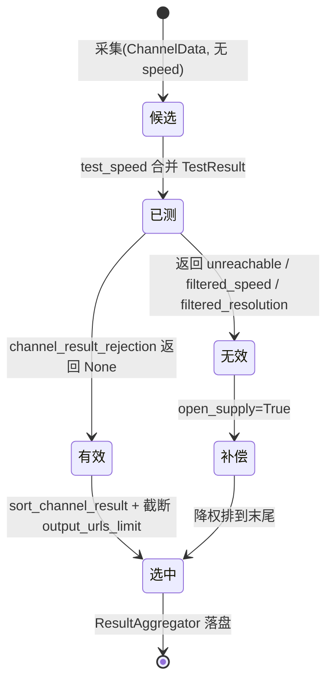

# 05 · 数据模型与配置

本章拆两种"数据模型"：**对外播放列表**（主仓库真正交付的东西）与 **iptv-api 的内部结构**（采集/测速/持久化用的类型与表）。最后给出 `config.ini` 的配置体系。

---

## 一、对外播放列表

主仓库只维护两份文件，位于 [`河南移动/`](../../河南移动/)：

| 文件 | 格式 | 条数 | 分组 |
|---|---|---|---|
| [`河南移动.m3u`](../../河南移动/河南移动.m3u) | M3U（扩展属性 + EPG） | 283 | 14 |
| [`河南移动.txt`](../../河南移动/河南移动.txt) | DIYP（`#genre#` 分组） | 283 | 14 |

### 1.1 M3U 结构

```m3u
#EXTM3U x-tvg-url=http://epg.51zmt.top:8000/cc.xml,http://epg.51zmt.top:8000/difang.xml
#EXTINF:-1 tvg-id="CCTV1" tvg-name="CCTV1" group-title="央视频道",CCTV1
http://iptv.cdn.ha.chinamobile.com/PLTV/88888888/224/3221227262/index.m3u8
#EXTINF:-1 tvg-id="CCTV1" tvg-name="CCTV1" group-title="央视频道",CCTV1·备用线路1
http://iptv.cdn.ha.chinamobile.com/PLTV/88888888/224/3221226304/index.m3u8
```

| 元素 | 取值 / 含义 |
|---|---|
| 首行 | 必须是 `#EXTM3U`；`x-tvg-url` 声明 EPG 地址（多个用逗号分隔） |
| `#EXTINF:-1` | 固定时长 `-1`（直播流） |
| `tvg-id` | 频道标识，用于匹配节目单；备用线路复用同一 `tvg-id` |
| `tvg-name` | 频道标准名 |
| `group-title` | 分组，即播放器中的分类；**不得包含逗号** |
| 逗号后的文本 | 展示名称；备用线路以 `·备用线路N` 后缀区分 |
| 下一行 | 播放地址（`http(s)://` / `rtmp://` / `rtsp://`） |

> 该仓库成品未使用 iptv-api 的 `$` 描述段、`#EXTVLCOPT` 请求头与 catchup 属性；这些能力见本章第 2 节（子模块生成的产物）。

### 1.2 DIYP TXT 结构

```txt
央视频道,#genre#
CCTV1,http://iptv.cdn.ha.chinamobile.com/PLTV/88888888/224/3221227262/index.m3u8
CCTV1·备用线路1,http://iptv.cdn.ha.chinamobile.com/PLTV/88888888/224/3221226304/index.m3u8
```

- `分组名,#genre#` 单独成行，开启一个分组；
- `频道名,URL` 每行一条，属于上方最近的分组；
- 空行仅用于可读性，解析时可忽略。

### 1.3 一致性约束（由 CI 强制）

| 约束 | 校验方 |
|---|---|
| 两份文件均为 283 条、14 分组 | [iptv-health-check.yml](../../.github/workflows/iptv-health-check.yml) |
| 频道名集合、URL 集合、`(分组,频道名,URL)` 映射逐一相等（顺序可不同） | [check_playlist_equivalence.py](../../.github/scripts/check_playlist_equivalence.py) |
| 每个 `#EXTINF` 后必须有 URL；URL 不重复 | 同上 workflow 的结构检查 |
| m3u 中不得出现 `#genre#`；分组名不得含逗号 | 同上 workflow 的分组质量检查 |
| README 表格声明的数量与文件实际数量一致 | 同上 workflow |

---

## 二、iptv-api 内部数据结构

### 2.1 类型别名（[utils/types.py](../../tools/iptv-api/utils/types.py)）

| 类型 | 定义 | 用途 |
|---|---|---|
| `OriginType` | `Literal["hls", "local", "whitelist", "subscribe"]` | 接口来源 |
| `IPvType` | `Literal["ipv4", "ipv6", None]` | 协议栈归属 |
| `CategoryChannelData` | `dict[str, dict[str, list[ChannelData]]]` | 分类 → 频道 → 候选接口列表 |
| `TestResultCacheData` | `dict[str, list[TestResult]]` | 频道 → 历史测速结果 |
| `ChannelTestResult` | `Union[ChannelData, TestResult]` | 采集结果或测速结果的联合类型 |
| `WhitelistMaps` | `tuple[dict[str, list[str]], dict[str, list[str]]]` | 白名单的频道映射与 URL 映射 |

### 2.2 `ChannelData`（[L7-L27](../../tools/iptv-api/utils/types.py#L7-L27)）

一条"候选接口"的完整描述。`id` 为必填，其余标 `NotRequired` 的字段在采集阶段可能尚未确定。

| 字段 | 类型 | 必填 | 含义 |
|---|---|---|---|
| `id` | `str` | ✓ | 接口唯一标识（由 URL + headers 等派生的稳定键） |
| `url` | `str` | ✓ | 播放地址（不含 `$` 描述段） |
| `host` | `str` | ✓ | 由 URL 解析出的主机，用于 `speed_test_filter_host` 复用测速 |
| `origin` | `OriginType` | ✓ | `local` / `subscribe` / `whitelist` / `hls` |
| `ipv_type` | `IPvType` | ✓ | 解析出的协议栈；用于 IPv4/IPv6 结果分流 |
| `date` | `str \| None` | | 采集日期 |
| `resolution` | `str \| None` | | 如 `1920x1080`，测速阶段由 FFprobe 写入 |
| `video_codec` / `audio_codec` | `str \| None` | | 编码格式（`h264` / `hevc` / `aac` ...） |
| `fps` | `float \| None` | | 帧率 |
| `location` / `isp` | `str \| None` | | 归属地 / 运营商（IP 库查询结果） |
| `headers` | `dict[str, str] \| None` | | 请求头（`#EXTVLCOPT` / m3u 属性） |
| `catchup` | `dict[str, str] \| None` | | 回看模板参数 |
| `tvg_logo` | `str \| None` | | 订阅源自带台标 |
| `extra_info` | `str` | | 原 `$` 后的描述文本 |
| `supply` | `bool` | | 是否为补偿机制加入的降级接口 |

### 2.3 `TestResult`（[L33-L43](../../tools/iptv-api/utils/types.py#L33-L43)）

测速产出，字段与 `ChannelData` 的测速子集同名，便于直接合并：

| 字段 | 类型 | 含义 |
|---|---|---|
| `speed` | `int \| float \| None` | 下载速率（MiB/s）；`None` 表示不可用 |
| `delay` | `int \| float \| None` | 首字节延迟（ms） |
| `resolution` | `str \| None` | 分辨率 |
| `video_codec` / `audio_codec` | `str \| None` | 编码 |
| `fps` | `float \| None` | 帧率 |

### 2.4 数据生命周期



判定逻辑集中在 [`channel_result_rejection`](../../tools/iptv-api/utils/channel_quality.py#L9-L75)，顺序为：白名单/HLS 保留 → 数值合法性 → `open_supply` 短路 → 速率过滤 → 分辨率过滤。

---

## 三、产物与落盘

### 3.1 目录结构

```text
tools/iptv-api/
├── config/                     # 输入（配置 + 数据源）
│   ├── config.ini              # 默认配置
│   ├── user_config.ini         # 用户覆盖配置（可选，持久化）
│   ├── demo.txt                # 频道模板（决定要哪些频道、分组顺序）
│   ├── local.txt               # 本地源（频道名,URL）
│   ├── local/                  # 本地源目录（支持 .txt/.m3u 批量导入）
│   ├── alias.txt               # 频道别名（模板名 → 实际名匹配）
│   ├── blacklist.txt           # 接口黑名单
│   ├── whitelist.txt           # 接口白名单（含 [KEYWORDS] 段）
│   ├── subscribe.txt           # 订阅源列表（# 开头为停用）
│   ├── epg.txt                 # EPG 源列表
│   ├── logo/                   # 台标缓存
│   └── hls/                    # 本地 HLS 文件目录
└── output/                     # 输出（不应提交 Git）
    ├── data/
    │   ├── cache.gz            # 测速结果缓存
    │   ├── frozen.gz           # 冻结结果
    │   ├── run_state.json      # 最近一次运行状态
    │   ├── channel_results.db  # 频道/候选/测速/快照 SQLite
    │   └── rtmp.db             # RTMP 探测元数据 SQLite
    ├── epg/                    # epg.xml / epg.gz
    ├── ipv4/                   # result.txt / hls.txt
    ├── ipv6/                   # result.txt / hls.txt
    ├── screenshots/            # 播放截图
    ├── result.txt / result.m3u # 全量结果
    ├── hls.txt / hls.m3u       # RTMP 推流结果
    └── log/
        ├── log.log             # 运行日志（含运行 ID）
        ├── result.log          # 有效结果日志
        ├── speed_test.log      # 测速日志
        ├── statistic.log       # 统计日志
        ├── unmatch.log         # 未匹配频道
        └── *.jsonl             # 上述日志的结构化版本
```

路径常量全部集中在 [`utils/constants.py`](../../tools/iptv-api/utils/constants.py#L6-L72)，代码不散落硬编码字符串。

### 3.2 实时写盘

由 [`ResultAggregator`](../../tools/iptv-api/utils/aggregator.py#L61) 承担：

1. 各频道测速完成后 `add_item` 进入内存字典；
2. 定时器按间隔 flush（去抖，避免每个频道都写文件）；
3. 写临时文件后 `os.replace` 原子替换，读方永远看到完整文件；
4. 计算渲染签名，内容未变化则跳过，降低磁盘 IO；
5. `stop()` 做最后一次强制 flush。

对应配置：`open_realtime_write = True`。

### 3.3 `run_state.json`

[`utils/run_state.py`](../../tools/iptv-api/utils/run_state.py) 写入，原子替换，结构：

```json
{
  "status": "running | completed | completed_empty | cancelled | failed | never_run",
  "updated_at": 1792730265.0,
  "run_id": "20261023-101500",
  "reason": "no_source_configured",
  "message": "..."
}
```

读取失败（文件不存在 / JSON 损坏）统一降级为 `{"status": "never_run"}`。

### 3.4 结构化日志

`log/*.jsonl` 每行一个 JSON 事件，与同名 `.log` 文本成对写出（[`ArtifactWriter`](../../tools/iptv-api/utils/artifacts.py#L13)）：

| 字段 | 说明 |
|---|---|
| `timestamp` | 本地时区 ISO 时间（秒精度） |
| `event` | 事件名，如 `run.start`、`run.failed` |
| `phase` | 阶段：prepare / collect / speed / output / complete |
| 其他 | 事件自定义字段 |

单文件默认上限 10000 条，超出后追加一条 `artifact.truncated` 声明丢弃数量。

---

## 四、SQLite 数据模型

### 4.1 `channel_results.db`

建表见 [`ensure_channel_repository`](../../tools/iptv-api/utils/channel_repository.py#L31-L243)，`PRAGMA user_version=2`，共 11 表 + 2 视图，构成**四层模型**：

| 层 | 表 | 说明 |
|---|---|---|
| 运行 | `runs` | 每次运行一行：`run_id`、起止时间、`status`、`config_hash`、`error` |
| 频道 | `channels` | 频道主数据与汇总（`health`、`best_speed`、`max_resolution`、`logo`、`selection_mode`） |
| 候选 | `channel_results` / `candidate_pool` / `candidate_history` / `candidate_measurements` | 当前候选快照、跨运行候选池、每轮候选与测速记录 |
| 输出 | `output_snapshots` / `channel_selection` | 每轮导出排名、人工选择（`included/excluded`、`pinned`、`manual_rank`） |
| 辅助 | `stream_samples` / `operation_history` / `stream_screenshots` | 推流采样、操作审计、截图状态 |

视图：

- `channel_candidates` → `channel_results` 的别名，兼容旧集成；
- `candidate_selection` → `channel_selection` 的语义化视图（`state`、`manual_rank`）。

关键约束：

- `channel_results` 主键 `(channel_key, result_key)`，外键级联删除到 `channels`；
- `output_snapshots` 主键 `(run_id, channel_key, result_key)`，保证每轮每频道排名唯一；
- 索引覆盖 `channels(category,name)`、`channel_results(result_key)`、`candidate_*` 的时间维度。

### 4.2 `rtmp.db`

[`utils/db.py`](../../tools/iptv-api/utils/db.py#L15-L29) 定义单表 `result_data`，供 RTMP 服务与结果生成共享探测元数据：

| 列 | 类型 | 含义 |
|---|---|---|
| `id` | TEXT PK | 接口标识 |
| `url` | TEXT | 地址 |
| `headers` | TEXT | JSON 序列化的请求头 |
| `video_codec` / `audio_codec` | TEXT | 编码 |
| `resolution` | TEXT | 分辨率 |
| `fps` | REAL | 帧率 |

### 4.3 连接与可靠性

- `PRAGMA busy_timeout=30000`、`synchronous=NORMAL`；
- 默认 `journal_mode=WAL`；
- [`with_journal_fallback`](../../tools/iptv-api/utils/db.py#L62) 在 WAL 触发 `SQLITE_IOERR` / `SQLITE_CANTOPEN` 时自动切换到 `DELETE` 回滚日志，并把该库记入降级集合，后续连接直接使用降级模式（适配网络盘、只读挂载等环境）。

---

## 五、配置体系

### 5.1 分层与优先级


- 加载顺序见 [`ConfigManager.load`](../../tools/iptv-api/utils/config.py#L754-L794)：后者逐 section/key 覆盖前者；
- 环境变量覆盖见 [`override_config_with_env`](../../tools/iptv-api/utils/config.py#L796-L813)：对每个键依次尝试 `key`、`KEY`、`SECTION_key`、`SECTION_KEY`，命中第一个即生效；
- `public_url`、`http_proxy` 的空环境变量**不覆盖**已挂载配置（避免 Compose 的空占位清空用户配置）；
- 冻结（PyInstaller）运行时，默认配置从 `sys._MEIPASS/config/config.ini` 读取。

配置文件只有 `[Settings]` 一个分区，约 60 个键。

### 5.2 校验

[`ConfigManager.validate`](../../tools/iptv-api/utils/config.py#L1028) 在加载后执行，问题以 `ConfigIssue` 汇总，每种规则对应一类检查：

| 规则 | 检查内容 | 示例键 |
|---|---|---|
| `boolean` | 仅 `True` / `False` | `open_update`、`open_epg` |
| `integer` / `float` | 可解析、有限、上下界 | `speed_test_timeout`、`update_interval` |
| `enum` | 取值在白名单内 | `ipv_type`、`sort_by`、`performance_mode` |
| `list` | 逗号分隔、元素合法、无重复 | `location`、`isp`、`origin_type_prefer` |
| `times` | `HH:MM` 格式、逗号分隔 | `update_times` |
| `timezone` | IANA 时区（pytz 可解析） | `time_zone` |
| `public_url` | 完整 `http(s)://host[:port]`，且无账号/查询/片段 | `public_url` |
| `resolution` | `\d+x\d+` 且均大于 0 | `min_resolution` |
| `resolution_speed_map` | `分辨率:速率` 逐项合法 | `resolution_speed_map` |

校验失败会指出**值的来源**（默认配置 / 用户配置 / 环境变量名），便于定位。

### 5.3 关键配置项

**输出与显示**

| 键 | 默认 | 说明 |
|---|---|---|
| `source_file` | `config/demo.txt` | 频道模板 |
| `final_file` | `output/result.txt` | 结果文件 |
| `output_urls_limit` | `5` | 每频道导出接口数（旧别名 `urls_limit`） |
| `open_m3u_result` | `True` | 生成 m3u |
| `open_update_time` / `update_time_position` | `True` / `top` | 更新时间与位置 |
| `open_url_info` | `False` | 是否输出 `$` 后的描述信息 |

**数据源**

| 键 | 默认 | 说明 |
|---|---|---|
| `open_local` / `open_subscribe` | `True` / `True` | 本地源 / 订阅源开关 |
| `open_history` | `True` | 合并历史结果 |
| `open_auto_disable_source` | `False` | 失败源前加 `#` 停用 |
| `open_headers` | `True` | 使用 m3u 携带的请求头 |
| `user_agent` | 空 | 全局 UA；优先级：接口 > 订阅地址 > 全局 > 内置 |

**测速与过滤**

| 键 | 默认 | 说明 |
|---|---|---|
| `open_speed_test` | `True` | 测速总开关 |
| `speed_test_mode` | `quick` | `quick` / `full` / `manual` |
| `speed_test_timeout` | `10` | 单接口超时（秒） |
| `speed_test_limit` | `0` | 并发覆盖，`0` 由性能模式决定 |
| `open_filter_speed` / `min_speed` | `True` / `0.5` | 速率过滤（MiB/s） |
| `open_filter_resolution` / `min_resolution` / `max_resolution` | `True` / `1280x720` / `3840x2160` | 分辨率过滤 |
| `open_filter_ad` | `True` | 广告/占位循环流过滤 |
| `open_supply` | `False` | 结果不足时降级补偿 |
| `sort_by` | `speed` | 排序维度，可多级（如 `resolution,speed`） |

**服务与推流**

| 键 | 默认 | 说明 |
|---|---|---|
| `open_service` | `True` | 启动 Web 服务 |
| `service_port` | `8080` | 对外 HTTP 端口（旧别名 `nginx_http_port`） |
| `app_port` | `5180` | Flask 内部端口 |
| `public_url` | 空 | 生成外链用的完整公网地址；留空回退 `public_scheme` + `public_domain` + `PUBLIC_PORT` |
| `open_rtmp` | `True` | 推流功能（GitHub Actions 下自动禁用） |
| `nginx_rtmp_port` | `1935` | RTMP 端口 |
| `rtmp_max_streams` / `rtmp_idle_timeout` | `10` / `300` | 并发上限 / 空闲停止秒数 |

**调度与性能**

| 键 | 默认 | 说明 |
|---|---|---|
| `update_mode` | `interval` | `interval` 或 `time` |
| `update_interval` | `12` | 间隔小时数，`0` 表示只跑一次 |
| `update_times` | 空 | `HH:MM` 列表（`update_mode=time`） |
| `update_startup` | `True` | 启动即更新 |
| `time_zone` | `Asia/Shanghai` | 调度与时间显示时区 |
| `performance_mode` | `auto` | `auto` / `powersave` / `balance` / `fast` |

### 5.4 数据源文件格式

| 文件 | 行格式 | 说明 |
|---|---|---|
| `demo.txt` | `分组名,#genre#` 起头，下接 `频道名`（也可写 `频道名,指定接口`） | 模板；出现顺序即输出分组/频道顺序 |
| `local.txt` | `频道名,URL` | 本地源；URL 后加 `$!` 表示该接口进白名单 |
| `subscribe.txt` | 每行一个订阅 URL | `#` 开头为停用 |
| `epg.txt` | 每行一个 EPG URL | 同上 |
| `whitelist.txt` | `频道名,URL`；另有 `[KEYWORDS]` 段 | 白名单接口跳过测速与过滤，置顶保留；关键词命中同效 |
| `blacklist.txt` | 每行一个 URL | 采集阶段直接剔除 |
| `alias.txt` | `模板名,实际名` | 解决不同源命名差异 |

> `local/` 目录支持 `.txt` 与 `.m3u`，启动时批量导入；格式与 `local.txt` 相同。

GUI 的编辑能力对应 [`utils/user_actions.py`](../../tools/iptv-api/utils/user_actions.py)：增删白/黑名单、频道与手动接口，全部走"临时文件 + `os.replace`"的原子写。

---

## 六、相关章节

- 类型如何被消费：[04 关键类与函数](./04-关键类与函数.md)
- 依赖与许可证：[06 依赖与许可证](./06-依赖与许可证.md)
- 配置如何影响运行：[07 运行与部署](./07-运行与部署.md)
