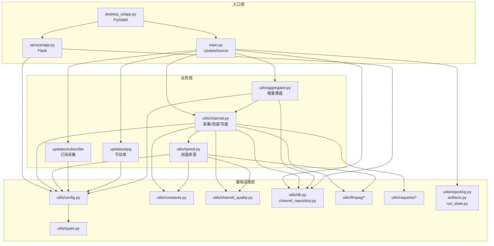

# 06 · 依赖与许可证

本仓库是"数据 + 工具 + CI"的混合体，依赖分布极不均匀：**主仓库零运行时依赖**，真正的依赖集中在两个工具目录，且三部分适用不同许可证。本章按"谁依赖什么 → 内部怎么连 → 法律边界在哪"组织。

---

## 一、主仓库

| 项 | 结论 |
|---|---|
| 运行时依赖 | **无**。仓库交付的是 `.m3u` / `.txt` 文本与被 CI 调用的脚本 |
| 自检脚本依赖 | 仅 Python 标准库：`os`、`re`、`sys`、`pathlib`（见 [check_playlist_equivalence.py](../../.github/scripts/check_playlist_equivalence.py#L14-L21)） |
| CI 依赖 | GitHub Actions 官方 action（`actions/checkout`、`actions/upload-artifact`、`actions/github-script` 等）+ `grep` / `curl` 等 runner 自带命令 |
| 依赖清单 | 没有 `package.json` / `requirements.txt` / `Pipfile`；需维护的依赖只有子模块与工具目录（由 Dependabot 跟踪） |

这也是为什么仓库根目录可以直接被播放器当订阅源使用——它不需要构建。

---

## 二、`tools/iptv-checker`（Node.js）

### 2.1 运行环境

| 项 | 值 | 来源 |
|---|---|---|
| Node.js | `>=22.12.0` | [package.json `engines`](../../tools/iptv-checker/package.json#L8-L10) |
| 模块系统 | ESM（`"type": "module"`） | 同上 |
| 全局安装 | `preferGlobal: true`，bin 名 `iptv-checker` | 同上 |
| 版本 | 0.30.3（上游最后一版） | 同上 |
| 外部可执行 | **FFmpeg / ffprobe**（`command-exists` 检查） | [PlaylistTester.js](../../tools/iptv-checker/src/core/PlaylistTester.js) |

### 2.2 生产依赖（`dependencies`，15 个）

| 包 | 作用 |
|---|---|
| `axios` + `axios-retry` | HTTP 探测、重试 |
| `async` | `eachLimit` 控制并发批次 |
| `commander` | CLI 参数解析 |
| `iptv-playlist-parser` | M3U 解析 |
| `normalize-url` + `valid-url` | URL 规范化与合法性校验 |
| `get-stdin` | 支持管道输入播放列表 |
| `socks-proxy-agent` | SOCKS 代理 |
| `command-exists` | 检测 `ffprobe` |
| `progress` | 进度条 |
| `colors` / `dateformat` | 终端着色与时间戳 |
| `msw` | **特殊**：`src/index.js` 顶层 `import { server } from '../tests/__mocks__/node.js'`，测试开关 `TESTING` 决定是否 `server.listen()`；因此 msw 被放进生产依赖 |
| `eslint` | **特殊**：上游把它放在 `dependencies` 而非 `devDependencies`，属于历史遗留 |

### 2.3 开发依赖（6 个）

`jest` 29、`babel-jest` 29、`@babel/core` 7、`@babel/preset-env` 7、`@jest/globals` 29、`fs-extra` 11。

脚本：

| 脚本 | 命令 |
|---|---|
| `npm test` | `node --experimental-vm-modules node_modules/jest/bin/jest.js` |
| `npm run lint` | `npx eslint "./{src,test}/**/*.js"` |

> 跑测试前建议剥离系统代理（`env -u http_proxy -u https_proxy npm test`）：axios 与 msw 组合在代理环境下可能产生畸形请求。

### 2.4 已知依赖告警

`npm audit` 的 33 条路径告警全部来自 jest/babel 开发链路，根因是 `sprintf-js`（中危）与 `braces`（高危，上游无修复版）；**不影响 CLI 运行时功能**。彻底修复需把 jest/babel 升到 30，属于破坏性主版本升级，按"快照不改上游源码"的策略暂不接收。

---

## 三、`tools/iptv-api`（Python）

### 3.1 运行环境

| 项 | 值 | 来源 |
|---|---|---|
| Python | **3.14** | [Pipfile `[requires]`](../../tools/iptv-api/Pipfile#L41-L42) |
| 依赖管理 | Pipenv（`Pipfile` + `Pipfile.lock` 精确锁定） | 同上 |
| 外部可执行 | **FFmpeg**（分辨率探测、截图、推流）、**nginx + nginx-rtmp-module**（推流/反代） | [Dockerfile](../../tools/iptv-api/Dockerfile)、[service/rtmp.py](../../tools/iptv-api/service/rtmp.py#L1-L40) |
| 内置数据 | `utils/ip_checker/data/qqwry.ipdb.gz`（IP 归属地库，首次运行解压并校验 SHA-256） | [ip_checker.py](../../tools/iptv-api/utils/ip_checker/ip_checker.py#L14-L60) |

### 3.2 生产依赖（`packages`，12 个，全部锁定 ==）

| 包 | 用途 |
|---|---|
| `aiohttp` + `async-timeout` | 异步 HTTP 采集与测速 |
| `requests` | 同步请求（RTMP 探测、部分工具） |
| `flask` + `gunicorn` | Web 结果服务 |
| `m3u8` | HLS 播放列表解析（测速、广告判定） |
| `bs4` | HTML/XML 解析 |
| `pytz` | 时区处理与配置校验 |
| `opencc-python-reimplemented` | 简繁转换（频道名匹配） |
| `ipip-ipdb` | 读取 qqwry IP 库 |
| `urllib3` | HTTP 底层 |
| `rich` | 终端富文本输出 |

### 3.3 开发依赖（`dev-packages`，9 个）

| 包 | 平台标记 | 用途 |
|---|---|---|
| `pyinstaller` 6.21.0 | 全平台 | 打包 GUI |
| `pyside6` 6.11.1、`pyside6-fluent-widgets` 1.11.2、`pysidesix-frameless-window` 0.8.2 | 全平台 | 桌面 GUI 与主题 |
| `pillow` 12.3.0 | 全平台 | 图像处理（托盘图标等） |
| `pefile`、`pywin32`、`pywin32-ctypes` | Windows | 图标/进程与打包细节 |
| `pystray` | 非 Linux | 系统托盘 |

> GUI 依赖放在 `dev-packages`：Docker / 服务部署只需 `pipenv install --deploy`（不装 dev），桌面端才需要 `pipenv install --dev`。

### 3.4 Pipenv 脚本

| 脚本 | 命令 | 场景 |
|---|---|---|
| `dev` | `python main.py` | 跑一次/定时更新 |
| `service` | `python service/app.py` | 只起 Web 服务 |
| `ui` | `python -m desktop_ui.app` | 桌面 GUI |
| `ui_build` | `pyinstaller --clean --noconfirm desktop_ui/desktop_ui.spec` | 打安装包 |
| `legacy_ui` / `legacy_ui_build` | Tkinter 旧界面 | 已弃用，仅兼容 |
| `docker_run` / `docker_build` | 镜像运行 / buildx 多架构构建 | 发布 |

---

## 四、内部依赖关系

### 4.1 iptv-api 分层



依赖方向严格单向：**入口 → 业务 → 基础设施**。基础设施层之间只有 `config` 被广泛依赖，`types` / `constants` 保持叶子节点、无反向引用，避免循环导入。

### 4.2 关键耦合点

| 耦合 | 说明 |
|---|---|
| `utils/channel.py` ↔ `utils/speed.py` | `channel` 调用 `speed` 的原语，`speed` 反向调用 `channel_quality` 判定有效性；两者不互相 import，靠 `speed.py` 提供纯函数 |
| `utils/aggregator.py` → `utils/channel.py` | 聚合器复用频道排序/渲染函数，是唯一"业务层内反向依赖" |
| `service/rtmp.py` → `utils/ffmpeg` + `utils/db` | 推流服务直接复用探测封装与 `rtmp.db` |
| `desktop_ui` → `main` / `service` | GUI 以子进程/线程方式驱动更新与服务，不复制业务逻辑 |

### 4.3 iptv-checker 依赖方向

```text
bin/iptv-checker.js
  └─ src/index.js (IPTVChecker)
       ├─ core/PlaylistTester.js ─ core/PlaylistParser.js
       │                          └─ core/StreamTester.js
       │                               ├─ core/StreamLoader.js
       │                               ├─ core/FFprobe.js ─ FFprobeCommandBuilder.js
       │                               │                  ├─ FFprobeOutputParser.js
       │                               │                  └─ FFprobeErrorParser.js
       │                               └─ core/HttpErrorParser.js
       ├─ core/Playlist.js
       ├─ core/Cache.js / Logger.js / ProxyParser.js / utils.js
       └─ errors.js / constants.js
```

无循环依赖；`errors.js` 与 `constants.js` 为叶子模块。唯一的"怪点"是 `src/index.js → tests/__mocks__/node.js`，把测试桩引入了生产入口（见 2.2）。

---

## 五、许可证

### 5.1 三块边界

| 路径 | 来源 | 许可证 | copyleft 强度 |
|---|---|---|---|
| 根目录自有文件、`河南移动/`、`.github/` | 本仓库 | MIT（[LICENSE](../../LICENSE)） | 无 |
| `tools/iptv-checker/` | `freearhey/iptv-checker` v0.30.3 | MIT | 无 |
| `tools/iptv-api/` | `Guovin/iptv-api` v3.1.0 | **AGPL-3.0**（[LICENSE](../../tools/iptv-api/LICENSE)） | 强 |

完整第三方清单见 [THIRD-PARTY.md](../../THIRD-PARTY.md)。

### 5.2 为什么必须用 submodule

AGPL-3.0 的关键条款：**只要通过网络向用户提供服务，就必须向用户提供完整对应源码**。若把 `iptv-api` 代码直接并入本仓库：

1. 法律上构成组合作品（combined work）；
2. 整个仓库被迫以 AGPL-3.0 发布；
3. 本仓库原有 MIT 内容无法继续保持宽松条款。

隔离为 [git submodule](../../.gitmodules) 后，它是独立作品，指针只记录 commit，MIT 部分不受传染。代价是克隆需要 `--recurse-submodules` 或 `git submodule update --init`。

### 5.3 使用时的合规要点

| 场景 | 义务 |
|---|---|
| 只播放 `河南移动/*.m3u` | 无需任何额外动作（MIT 数据） |
| 本地/自用运行 `iptv-api` | AGPL 允许自用；修改后分发需开源 |
| 把 `iptv-api` 作为网络服务对外提供 | **必须**向使用者提供完整修改后源码 |
| 分发包含 `iptv-api` 的镜像/安装包 | 附源码与 AGPL 许可证文本 |
| 分发 `iptv-checker` | 保留 MIT 版权声明 |

---

## 六、依赖升级策略

由 [dependabot.yml](../../.github/dependabot.yml) 驱动：

| 目标 | 生态 | 频率 | 策略 |
|---|---|---|---|
| `tools/iptv-checker` | npm | 每周一 | 接受锁文件内补丁/次版本；忽略主版本；不改上游源码 |
| `tools/iptv-api` | gitsubmodule | 每周一 | 只提指针升级 PR，人工评估上游变更 |
| `.github/workflows` | github-actions | 每月 | 跟随 action 版本 |

原则：**工具目录是上游快照，修改只发生在锁文件与配置层**，保证将来同步上游时能干净比对。

---

## 七、相关章节

- 模块职责细节：[03 模块职责](./03-模块职责.md)
- 配置项全表：[05 数据模型与配置](./05-数据模型与配置.md)
- CI 如何验证依赖与数据：[08 质量保障与维护](./08-质量保障与维护.md)
