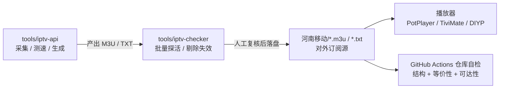

# IPTV 聚合仓库 · Code Wiki

本目录是对 [`nanxunzlq/iptv`](../../README.md) 仓库的完整代码维基，覆盖项目定位、整体架构、模块职责、关键类与函数、数据模型、依赖关系、运行方式与质量保障。

> 分析基线：主仓库（2026-10 工作区快照）+ 子模块 `tools/iptv-api`（v3.1.0，commit `2a4d925`）+ 快照 `tools/iptv-checker`（v0.30.3）。
> 文中代码链接均指向仓库内真实文件与行号，可直接跳转阅读源码。

---

## 1. 这个项目是什么

一句话：**一个"直播源数据 + 两个工具"的 IPTV 聚合仓库**。

| 组成部分 | 路径 | 本质 | 语言/技术 |
|---|---|---|---|
| 河南移动直播源 | [`河南移动/`](../../河南移动/) | 283 条频道、14 个分组的 m3u / DIYP txt 双格式数据 | 纯文本数据 |
| 链接探活工具 | [`tools/iptv-checker/`](../../tools/iptv-checker/) | 批量检查 m3u 链接可用性的 CLI | Node.js 22+ / ESM |
| 源自动生成工具 | [`tools/iptv-api/`](../../tools/iptv-api/) | 采集 → 聚合 → 测速 → 输出播放列表的完整系统 | Python 3.14 / asyncio / Flask / PySide6 |
| 仓库自检 | [`.github/`](../../.github/) | 结构、一致性、订阅可达性校验 + Dependabot | GitHub Actions |

三个部分不是同一个程序，而是**一条流水线**：



---

## 2. 文档地图

| 章节 | 内容 | 适合谁读 |
|---|---|---|
| [01 项目总览](./01-项目总览.md) | 仓库定位、资产清单、技术栈、数据规模、阅读路线 | 第一次接触本项目 |
| [02 整体架构](./02-整体架构.md) | 分层架构、数据流、运行时形态、关键设计决策 | 架构师 / 维护者 |
| [03 模块职责](./03-模块职责.md) | 三大子系统逐模块职责表与依赖方向 | 开发者 |
| [04 关键类与函数](./04-关键类与函数.md) | 核心类、方法签名、调用链、返回值约定 | 二次开发 / 排障 |
| [05 数据模型与配置](./05-数据模型与配置.md) | ChannelData 类型、播放列表格式、产物目录、SQLite 表、config.ini | 配置与数据维护 |
| [06 依赖与许可证](./06-依赖与许可证.md) | npm / Pipenv 依赖清单、内部依赖图、MIT 与 AGPL 边界 | 合规 / 升级依赖 |
| [07 运行与部署](./07-运行与部署.md) | 订阅使用、CLI、GUI、Docker、GitHub Actions、常见问题 | 部署 / 使用者 |
| [08 质量保障与维护](./08-质量保障与维护.md) | 自检工作流、测试体系、Dependabot、已知问题与维护流程 | 维护者 / CI 负责人 |

---

## 3. 快速事实

- **频道规模**：m3u 与 txt 各 283 条、14 个分组，频道名 / URL / 分组逐一一致（顺序可不同），由 [check_playlist_equivalence.py](../../.github/scripts/check_playlist_equivalence.py) 守门。
- **源可达性**：`iptv.cdn.ha.chinamobile.com` 为河南移动宽带内网源，**非该网络环境不可播**；因此 CI **不做**日常探活，只做文件一致性校验。
- **三个许可证**：仓库自有内容 MIT、iptv-checker MIT、iptv-api **AGPL-3.0**（以 submodule 隔离，避免 copyleft 传染整个仓库）。
- **主仓库无运行时依赖**：它是数据仓库；依赖只存在于 `tools/iptv-checker`（npm）与 `tools/iptv-api`（Pipenv）。
- **测试**：iptv-checker 的 Jest 套件 16/16 通过；iptv-api 有 42 个 Python 测试模块（`unittest`）。

---

## 4. 仓库结构与文档对应关系

```text
iptv/
├── 河南移动/
│   ├── 河南移动.m3u              # 283 条 / 14 分组，含 tvg-id、EPG 地址
│   └── 河南移动.txt              # 283 条 / 14 分组，DIYP 格式
├── tools/
│   ├── iptv-api/                 # git submodule（AGPL-3.0，v3.1.0）
│   └── iptv-checker/             # 上游快照（MIT，v0.30.3）
├── .github/
│   ├── workflows/iptv-health-check.yml
│   ├── scripts/check_playlist_equivalence.py
│   └── dependabot.yml
├── docs/
│   ├── ecosystem.md              # IPTV 生态索引
│   ├── 河南移动-河南电信频道对照.md  # 移动 ↔ 电信频道对照与缺口
│   └── wiki/                     # ← 本 Code Wiki
├── README.md                     # 面向使用者的说明
├── THIRD-PARTY.md                # 第三方组件与许可证
├── LICENSE                       # MIT（仅自有内容）
└── .gitmodules
```

---

## 5. 建议阅读顺序

1. 想**用现成直播源**：读 [01](./01-项目总览.md) → [07 的第 1 节](./07-运行与部署.md)。
2. 想**改/维护数据**：读 [05](./05-数据模型与配置.md) → [08](./08-质量保障与维护.md)。
3. 想**二次开发工具**：读 [02](./02-整体架构.md) → [03](./03-模块职责.md) → [04](./04-关键类与函数.md)。
4. 想**部署 iptv-api**：直接读 [07](./07-运行与部署.md) 与 [05 的配置章节](./05-数据模型与配置.md)。
